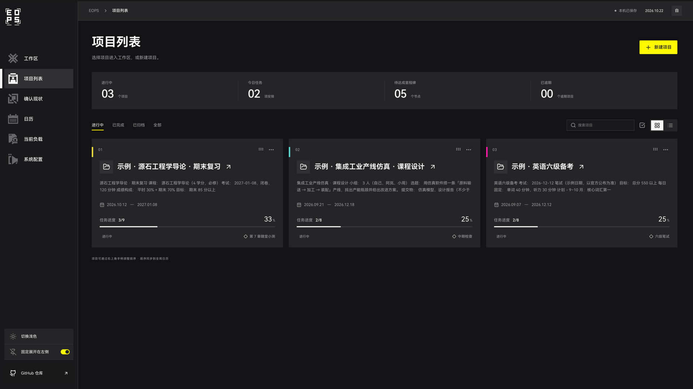
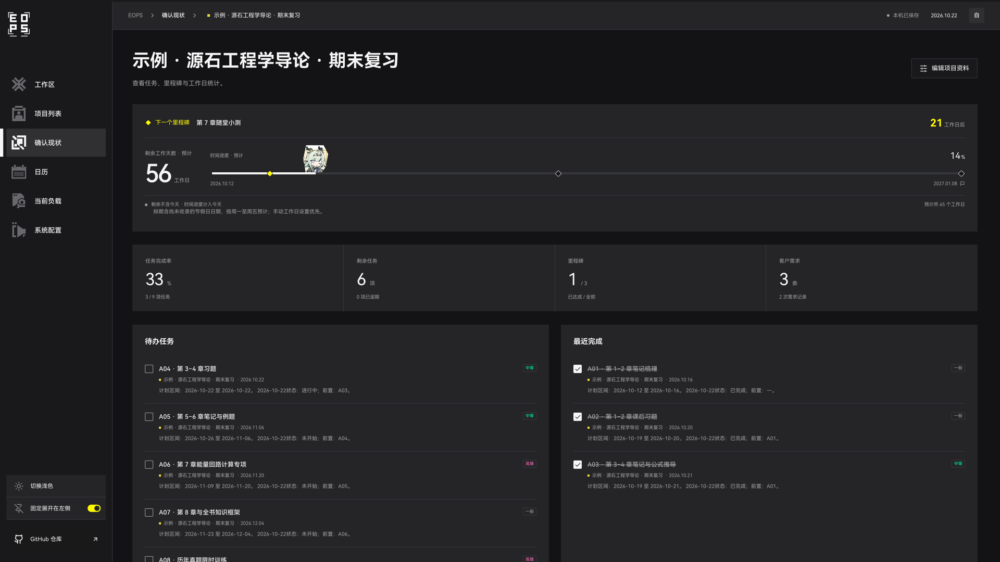
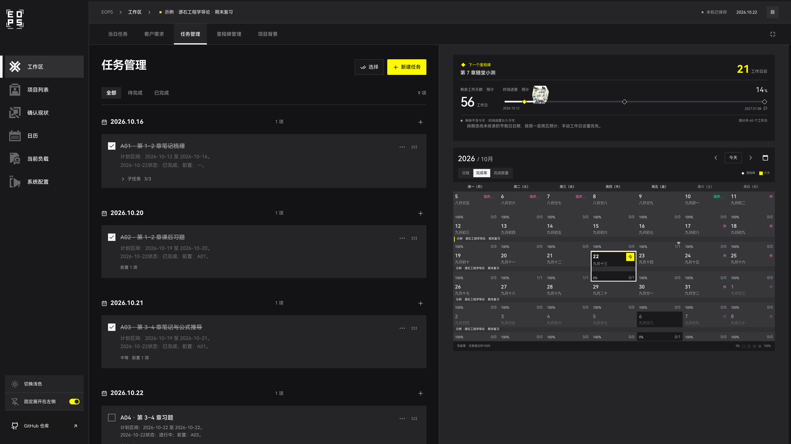
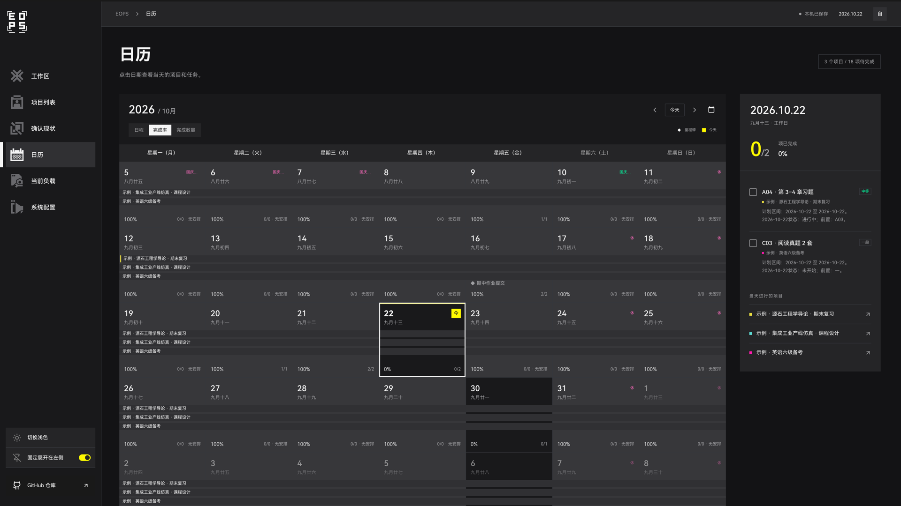
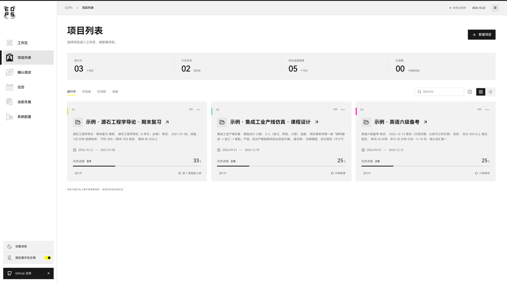

# EOPS 终末地工业项目中枢

**一个「终末地风格的个人用项目管理系统」。**

EOPS（Endfield OPS；Endfield Operations & Project System）本质是一个项目管理系统，采用受《明日方舟：终末地》启发的工业界面风格，**适合学生和个人使用**：期末复习、考试备考、课程设计、毕业论文，以及个人开发项目和日常任务安排。它是独立开发的非官方个人工具，与鹰角网络、GRYPHLINE 及游戏官方没有隶属、合作或背书关系。

**免费、公开源码，限非商业用途。** 软件许可为 [PolyForm Noncommercial 1.0.0](LICENSE.md)，允许在许可范围内使用、修改与分发。本项目不授予现实商业用途的使用权，包括商业项目交付管理、付费服务和商业产品集成。非商业个人开发与兴趣项目管理可以使用；具体许可范围以协议原文为准。由于保留非商业限制，准确分类为 **source-available（公开源码）**，并非 OSI 定义的开源软件。第三方依赖、字体及原作相关权利分别适用各自条款。

版本：**0.1.0** · 分支：**Adrian-v0.1** · 当前支持：**macOS 单人本机使用**

[代码仓库](https://github.com/QianhanOfficial/EndfieldOPS) · [下载 Release](https://github.com/QianhanOfficial/EndfieldOPS/releases) · [素材与署名](docs/ASSETS.md) · [许可说明](docs/LICENSING.md)

## 当前功能

- **项目管理**：新建及编辑项目背景、参考起止日期和成员；列表／方格视图、排序、多选、手动完成与归档。
- **需求与任务**：按批次记录新增／改进／废弃需求；安排任务、子任务、工作量、多个工作者、前置依赖与里程碑。
- **日历与进度**：周历、农历、调休标识、跨项目色带、完成率与负载；分别展示时间进度、任务完成率和里程碑状态。
- **个人配置**：浅色／深色、字体大小、日期格式、侧栏固定、减少动态效果与工作日例外。
- **本机数据**：SQLite 持久保存、JSON 导出与恢复、本机备份；提供可选的本机 stdio MCP 适配器。

无需登录，不需要订阅、云端数据库或外部 AI 服务。服务只监听 `127.0.0.1:11325`。当前尚无多人权限、审批流、合同财务、自动 AI 排期、跨项目风险联动或附件系统；二创示例中的相关内容作为背景文档保存。

## 界面预览

截图使用手动载入的学生向示例项目（快照 2026-10-22），均为虚构数据。



| 确认现状 | 任务管理 |
| --- | --- |
|  |  |
| **日历** | **浅色主题** |
|  |  |

## 在 macOS 上使用

### 下载使用包

从 [Release](https://github.com/QianhanOfficial/EndfieldOPS/releases) 下载 `EndfieldOPS-0.1.0-macOS.zip` 并解压到可写文件夹。使用包包含已构建网页，**日常启动无需 Node.js 或安装前端依赖**；需要本机已有 **Python 3.9 或更新版本**（可从 [Python 官方网站](https://www.python.org/downloads/macos/) 安装）。本项目没有捆绑 Python 运行时，也不提供签名的 `.app` 安装程序。

在 Finder 中双击：

| 文件 | 作用 |
| --- | --- |
| [启动EOPS.command](启动EOPS.command) | 后台启动服务并打开网页；重复运行不会多开服务。 |
| [停止EOPS.command](停止EOPS.command) | 核验本项目进程身份后停止服务，保留数据。 |
| [备份EOPS.command](备份EOPS.command) | 生成 JSON 与 SQLite 备份，服务运行或停止时均可使用。 |

访问 [http://127.0.0.1:11325](http://127.0.0.1:11325)。重启 Mac 后再次启动即可；启动失败时检查 `data/server.log`。11325 端口被占用时，EOPS 会提示，保留其他服务。

### 从源码运行

源码开发另需 **Node.js 20.19+ 的 20.x，或 Node.js 22.12+**；不支持 Node.js 21。首次构建需要网络：

```sh
git clone --branch Adrian-v0.1 https://github.com/QianhanOfficial/EndfieldOPS.git
cd EndfieldOPS
npm ci
npm run build
./启动EOPS.command
```

修改前端代码后重新执行 `npm run build`。Python 服务只使用标准库。

## 示例案例

空工作台的项目列表提供「体验示例项目」，手动载入三个可删除的学生向示例，共 25 条任务：

| 示例项目 | 场景 | 展示的用法 |
| --- | --- | --- |
| 源石工程学导论 · 期末复习 | 一门课的期末复习 | 章节拆成任务和子任务；老师调整考试范围时，按批次记录新增／改进／废弃需求 |
| 集成工业产线仿真 · 课程设计 | 三人小组课程设计 | 多个工作者分工、多前置依赖、开题／中期／答辩里程碑 |
| 英语六级备考 | 考试备考 | 每日训练、整套模考依赖多项专项练习 |

示例内容由 AI 辅助编写，课程、人物和考试日期均为虚构；六级考试日期仅为示例，以官方公布为准。已有项目、任务等内容时，载入示例会被拒绝。

示例固定在 **2026-10-22** 的状态快照，日期不会随使用当天移动；期末考试排到 2027 年 1 月。任务按单日安排，以计划区间的结束日作为任务日期，完整区间和“进行中”等状态写在任务描述中。

<details>
<summary>二创设定相关</summary>

以下是早期版本演示案例使用的二创背景。当前内置示例已改为学生向，不再载入这些内容；它们也不影响普通个人项目的使用。

<details>
<summary>点击展开则视为您已知晓该内容为AI生成，不代表开发者对任何角色的理解与评价，该二创仅作为背景资料保存</summary>

**警告：AI生成，可能存在OOC。**

本设定由 GPT 生成，整理时保留了虚构项目的背景、任务与测试数据。组织关系、角色台词、职责与世界观描述均未作为官方设定核实；项目编号、现实公历排期、折金票金额、指标及事件均为模拟数据。阅读不构成对其中内容的认可。

整理后的设定统一收录在仓库明确标注的 **[杂项](杂项/README.md)** 中：[二创设定全文](杂项/二创设定.md)。设定提出的企业级能力仅为虚构背景或测试设想，不能视为当前软件功能。

</details>
</details>

## 数据、备份与恢复

所有业务数据保存在当前安装文件夹内。`data/`、`backups/`、日志和本机配置均排除在 Git、Release 使用包和公开源码之外。

| 内容 | 相对安装目录的路径 |
| --- | --- |
| SQLite 主数据库 | `data/dayline.sqlite3`（兼容原有安装的数据文件名） |
| 自动／手动备份 | `backups/` |
| 日志与进程记录 | `data/` |

原有数据库文件名和浏览器偏好键保留兼容，避免更名后丢失数据或草稿；界面及公开项目称呼统一为 EOPS。移动文件夹前先停止服务，并一同保留 `data/` 与 `backups/`。

网页「系统配置 → 数据与备份」支持导出 JSON、本机备份及从 JSON 恢复。恢复会替换整份工作台，执行前自动备份，且需在页面确认。数据库运行时可能有 `-wal` 和 `-shm` 文件，备份请使用应用或脚本提供的 SQLite 快照，避免只复制运行中的主文件。

## MCP 与数据边界

参见 [本机 MCP 接入说明](docs/MCP.md)。MCP 与网页使用同一本机 API，适配器支持读取和有限的创建、更新与排序，不直接写数据库。MCP 需要先运行 `npm ci`，Release 使用包没有预装这部分依赖。

应用本身不接入外部 AI。若自行连接云端模型客户端，工具返回的项目内容可能由该客户端发送至模型服务，取决于客户端配置。

## 验证与实现边界

```sh
npm run build
npm run test:dates
python3 -m unittest discover -s tests -p 'test_server.py' -v
node tests/mcp-smoke.mjs
```

后端测试使用临时数据库；默认 MCP 测试使用隔离服务。读取已启动实例的 MCP 验证可使用 `EOPS_TEST_URL=http://127.0.0.1:11325 node tests/mcp-smoke.mjs`。

发行维护者可在构建并暂存／提交源码后运行 `python3 scripts/package-release.py`，生成包含构建产物、排除个人数据的使用包与 SHA-256 校验文件。

前端使用 React、TypeScript、Vite，后端使用 Python 标准库和 SQLite。项目背景支持 Markdown 编辑与预览；任务依赖不会自动改期；逾期提示不会自动完成项目。数据结构见 [接口约定](docs/CONTRACT.md)。

支持日期范围为 1900-01-01 至 2099-12-31。中国工作日与农历使用固定版本 `chinese-days 1.5.9`，已知节假日覆盖 2004–2026 年，超出范围按周一至周五推算并标记为预计，个人工作日例外优先。完整状态大小上限为 8 MiB，适合个人轻量管理。

## 许可与原作声明

本仓库自有代码及原创界面素材适用 [LICENSE.md](LICENSE.md)；第三方依赖和字体见 [第三方声明](THIRD_PARTY_NOTICES.md) 与 [素材说明](docs/ASSETS.md)。**本软件使用 HarmonyOS Sans SC，Copyright 2021 Huawei Device Co., Ltd.** 字体许可单独附于发行包。

《明日方舟：终末地》相关名称、角色、世界观及商标的权利属于其原权利人。项目名称和示例语境均属非官方同人表达，本项目的许可证不授予这些第三方权利，也不表示获得官方认可或单独授权。

非商业定位参考 GRYPHLINE 发布的[《终末地》同人创作与直播指引](https://endfield.gryphline.com/en-us/news/4497)。该指引有适用范围及例外，不能概括为“所有同人创作一律禁止商用”，也不等于对本软件的单独授权；本仓库自行坚持上述非商业许可。为什么不用 MIT／GPL 等开源协议，见 [许可选择与依据](docs/LICENSING.md)。
